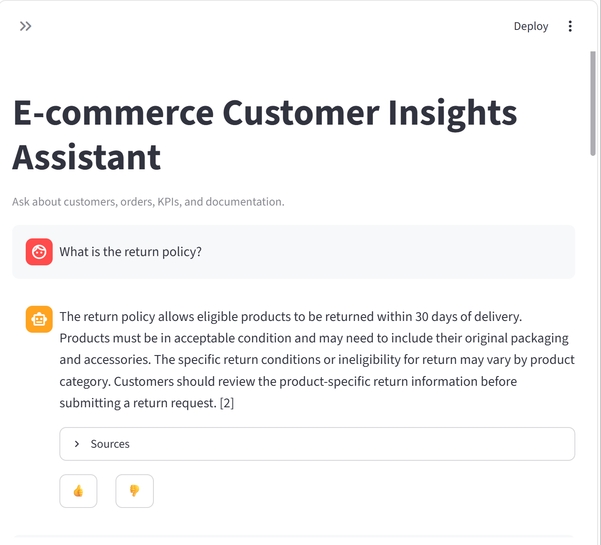

# 🤖 AI-Powered E-Commerce Customer Insights Assistant

> An end-to-end AI-powered customer insights platform combining data engineering, analytics, machine learning, RAG, bounded agent workflows, APIs, and production deployment.

[](https://www.python.org/)
[](https://fastapi.tiangolo.com/)
[](https://streamlit.io/)
[](https://www.postgresql.org/)
[](https://www.mongodb.com/)
[](https://www.docker.com/)

---

## 📌 Project Overview

The **AI-Powered E-Commerce Customer Insights Assistant** is an end-to-end data and AI application developed as an internship capstone project.

The system combines structured e-commerce data, analytics, machine learning, retrieval-augmented generation (RAG), and a bounded AI agent into a production-style application.

Instead of functioning as a simple chatbot, the system connects multiple layers of a modern data and AI stack:

**Data → Data Engineering → Analytics → Machine Learning → RAG → Agent Workflow → API → UI → Production Infrastructure**

The assistant can answer questions about:

- 👤 Customers
- 📦 Orders
- 📊 Business KPIs
- 💰 Revenue and sales performance
- 🛍️ Product performance
- 📚 E-commerce policies and documentation
- 🤖 Customer and business insights

The application also enforces bounded tool usage and prevents unsupported or destructive actions.

---
## 📸 Application Screenshots

### Streamlit Assistant



### Business KPI Analysis


# 🏗️ System Architecture

```text
                         ┌──────────────────────┐
                         │      Streamlit UI    │
                         │        :8501         │
                         └──────────┬───────────┘
                                    │
                                    ▼
                         ┌──────────────────────┐
                         │      FastAPI API     │
                         │        :8000         │
                         └──────────┬───────────┘
                                    │
                                    ▼
                         ┌──────────────────────┐
                         │ Conversation Service │
                         └──────────┬───────────┘
                                    │
                                    ▼
                         ┌──────────────────────┐
                         │   Bounded AI Agent   │
                         └──────────┬───────────┘
                                    │
              ┌─────────────────────┼─────────────────────┐
              │                     │                     │
              ▼                     ▼                     ▼
       Customer Lookup         Order Status          KPI Query
              │                     │                     │
              │                     │                     │
              └─────────────────────┼─────────────────────┘
                                    │
                                    ▼
                         ┌──────────────────────┐
                         │ Documentation Search │
                         │        RAG           │
                         └──────────┬───────────┘
                                    │
                       ┌────────────┼────────────┐
                       ▼            ▼            ▼
                   Chroma      Embeddings     Ollama
                   Vector       MiniLM        Qwen2.5
                   Store        L6-v2           3B
                                   
                                   
       ┌─────────────────────────────────────────────────────┐
       │                 Data Platform                       │
       │                                                     │
       │ Raw Data → Processing → PostgreSQL → Analytics/ML  │
       └─────────────────────────────────────────────────────┘

       Production Services:
       PostgreSQL │ MongoDB │ Ollama │ FastAPI │ Streamlit

✨ Key Capabilities
👤 Customer Intelligence
The assistant can retrieve customer information using customer IDs.
Example:
User:
Tell me about customer CUST-0001.

Assistant:
Customer CUST-0001 is Daniel Patel, from UAE, with status active.

📦 Order Intelligence
The system can retrieve real-time order information from the application data layer.
Example:
User:
What is the status of ORD-00001?

Assistant:
Order ORD-00001 has status pending.

The system supports order-status queries without allowing the agent to perform destructive order operations.
📊 Business KPI Analysis
The assistant can calculate and return important business metrics, including:
- Total orders
- Total customers
- Completed revenue
- Average order value
- Payment success rate
- Repeat-purchase rate
- Customer value
- Top-selling products
- Products generating the most revenue
Example:
User:
What are the key business KPIs?

Assistant:

Total orders: 500
Total customers: 99
Completed revenue: 431,177.98 AED
Average order value: 1,497.15 AED
Payment success rate: 57.60%
Repeat purchase rate: 81.91%
Customer value: 4,587.00 AED

📚 Retrieval-Augmented Generation
The project includes a dedicated RAG pipeline for answering documentation and policy-related questions.
The pipeline uses:
Documents
   ↓
Chunking
   ↓
Sentence Transformer Embeddings
   ↓
Chroma Vector Store
   ↓
Hybrid Retrieval
   ↓
Evidence Gate
   ↓
Qwen2.5:3b
   ↓
Grounded Answer + Citations

The embedding model used is:
all-MiniLM-L6-v2

with 384-dimensional embeddings.
The local language model is:
Qwen2.5:3b

served through Ollama.
The retrieval system combines semantic and keyword signals and applies an evidence gate before generating documentation-based responses.
🤖 Bounded Agent Workflow
The AI agent was deliberately designed as a bounded and deterministic workflow rather than an unrestricted autonomous agent.
Approved read-only tools include:
customer_lookup
order_status
kpi_query
documentation_search

The workflow follows a controlled sequence:
Understand Request
       ↓
Select Appropriate Tool
       ↓
Execute Tool
       ↓
Validate Result
       ↓
Synthesize Response
       ↓
Final Validation

The workflow is constrained by a step limit and tool policy.
This prevents the system from freely executing unsupported or destructive operations.
🛡️ Safety and Guardrails
The application includes safeguards for unsupported and destructive requests.
Examples of actions that are not allowed:
Cancel orders
Issue refunds
Delete customers
Delete data

For example:
User:
Delete customer CUST-0001.

Assistant:
I can help with customer lookups, order status,
KPI questions, and documentation-based questions.
I cannot perform destructive actions such as
cancelling orders, issuing refunds, or deleting data.

This provides a clear boundary between information retrieval and data-modifying operations.
🧠 Machine Learning
The project also includes a machine learning component for customer repeat-purchase prediction.
Baseline Model
Logistic Regression
Dataset characteristics:
Dataset shape:       84 × 24
Feature matrix:      84 × 21
Numerical features:  19
Categorical features: 2

Target distribution:
No repeat purchase: 51
Repeat purchase:    33

Evaluation was performed using:
5-Fold Stratified Cross-Validation

The trained model was exposed through an API service.
Example prediction:
Customer: CUST-0001
Prediction: Repeat purchase
Probability: ~0.606

🔎 RAG Evaluation
The retrieval system was evaluated using a dedicated evaluation set.
Metric	Result
Hit Rate @ 5	1.000
MRR	0.812
Source Accuracy	1.000
Citation Rate	1.000
Faithfulness	1.000
Answer Relevance	0.750
Evidence Failure	0.000
Mean Source Rank	1.250
Source MRR	0.875


Evaluation finding
The retrieval system demonstrated strong reliability on the evaluation set.
The primary limitation identified during evaluation was the specificity of responses generated by the local Qwen2.5 3B model rather than retrieval failure.
🗄️ Data Engineering
The project includes a structured data platform containing:
Source Tables
customers
orders
order_items
products
transactions

Warehouse / Mart
mart.dim_customer
mart.dim_order
mart.dim_product
mart.fact_order_items

Curated Data
customers.parquet
events.parquet
ml_customer_features.parquet
ml_predictions.parquet
orders.parquet
order_items.parquet
products.parquet
transactions.parquet

The data pipeline transforms source data into curated datasets and warehouse structures used by downstream analytics, machine learning, and AI components.
📈 Analytics
The analytics layer provides business-level metrics used by the AI assistant.
Key metrics include:
- Payment success rate
- Completed revenue
- Average order value
- Repeat-purchase rate
- Customer value
- Total orders
- Total customers
- Top-selling products
- Product revenue rankings
This allows the AI layer to answer questions using calculated business metrics rather than relying on generated assumptions.
🚀 API
The application exposes the assistant through FastAPI.
Example endpoint:
POST /chat

Example request:
{
  "session_id": "demo-session",
  "message": "What is the status of ORD-00001?"
}

Example response:
{
  "response": "Order ORD-00001 has status pending.",
  "tool_used": "order_status",
  "status": "success"
}

Health endpoint:
GET /health

🖥️ User Interface
The application includes a Streamlit interface connected to the FastAPI backend.
Browser
   ↓
Streamlit :8501
   ↓
FastAPI :8000
   ↓
AI Agent
   ↓
Tools / RAG / Data

The UI provides a conversational interface for interacting with the customer insights assistant.
🐳 Production Deployment
The application is containerized using Docker Compose.
Production services include:
Service	Purpose
FastAPI	Application API
Streamlit	User interface
PostgreSQL	Data warehouse / application database
MongoDB	Application data / persistence
Ollama	Local LLM serving


Production deployment is defined in:
docker-compose.production.yml

The production API includes a health check and the complete application can be started using Docker Compose.
🧪 Testing
The capstone API test suite was executed with:
python -m pytest 09_capstone\tests --cov=09_capstone --cov-report=term-missing -q

Result:
7 passed
93% total coverage

Additional validation included:
- API health checks
- Chat endpoint smoke tests
- Agent workflow validation
- Tool validation
- RAG retrieval validation
- Invalid request validation
- Docker container health checks
📂 Project Structure
intern-project/
│
├── 01_foundation/
│
├── 02_sql/
│
├── 03_pipeline/
│
├── 04_analytics/
│
├── 05_analytics/
│   ├── eda.ipynb
│   └── kpis.py
│
├── 06_ml/
│   ├── train_model.py
│   ├── evaluate_model.py
│   ├── feature_engineering.py
│   └── api/
│
├── 07_llm_rag/
│   ├── rag_pipeline.py
│   ├── build_vector_store.py
│   ├── evaluation/
│   └── artifacts/
│
├── 08_agents/
│   ├── agent_workflow.py
│   ├── tools.py
│   └── test_tools.py
│
├── 09_capstone/
│   ├── api/
│   ├── ui/
│   └── tests/
│
├── 10_capstone/
│   ├── CAPSTONE_CHARTER.md
│   └── CAPSTONE_DOCUMENTATION.md
│
├── docker-compose.production.yml
├── Dockerfile
├── Dockerfile.capstone
├── requirements.txt
└── README.md

🗓️ Internship Development Journey
The project was developed incrementally across a 12-week internship.
Week	Focus
Week 1	Engineering foundations
Week 2	SQL warehouse
Week 3	Data pipeline
Week 4	Analytics and KPI development
Week 5	Machine learning baseline
Week 6	ML service and API
Week 7	LLM foundations
Week 8	RAG pipeline
Week 9	Agent workflows
Week 10	AI application and API
Week 11	Production engineering
Week 12	Capstone integration and deployment


The Git history contains versioned milestones for the major stages of development.
🏷️ Release History
Major project milestones are tagged in Git:
v0.2-engineering-foundations
v0.3-sql-warehouse
v0.4-data-pipeline
v0.5-analytics
v0.6-ml
v0.7-ml-service
v0.8-llm-foundations
v0.9-rag
v1.0-agent-workflows
v1.1-ai-application
v1.2-release-candidate
v1.3-capstone

The latest release is:
v1.3-capstone

⚙️ Local Setup
1. Clone the repository
git clone https://github.com/raazia101/ai-ecommerce-customer-insights-assistant.git
cd ai-ecommerce-customer-insights-assistant

2. Create a virtual environment
python -m venv .venv

Activate it on Windows:
.venv\Scripts\Activate.ps1

3. Install dependencies
pip install -r requirements.txt

4. Configure environment variables
Create a local .env file with the required application configuration.
Do not commit credentials, API keys, passwords, or other secrets to GitHub.
🐳 Run with Docker
The production environment can be started with:
docker compose -f docker-compose.production.yml up -d --build

Check service status:
docker compose -f docker-compose.production.yml ps

The main application interfaces are:
API: http://localhost:8000
UI:  http://localhost:8501

API health check:
http://localhost:8000/health

🔐 Security Notes
This repository is intended to demonstrate an internship-scale production architecture.
Before deploying to a real environment:
- Store secrets using a dedicated secrets manager.
- Rotate development credentials.
- Restrict database exposure.
- Use HTTPS/TLS.
- Add authentication and authorization.
- Add production logging and monitoring.
- Pin and regularly update dependencies.
- Review dependency vulnerabilities.
- Restrict model/tool permissions according to business requirements.
📖 Documentation
Detailed project documentation is available in:
10_capstone/CAPSTONE_CHARTER.md
10_capstone/CAPSTONE_DOCUMENTATION.md

The capstone documentation covers:
- Project objectives
- Architecture
- Data engineering
- Analytics
- Machine learning
- LLM integration
- RAG
- Agent workflows
- API architecture
- UI
- Production deployment
- Testing
- Evaluation
- Limitations
- Future improvements
🔮 Future Improvements
Potential production enhancements include:
- Authentication and role-based access control
- More comprehensive automated testing
- Improved observability and tracing
- Expanded KPI coverage
- More advanced customer segmentation
- Improved recommendation capabilities
- Stronger conversational memory
- More sophisticated retrieval strategies
- Model evaluation across larger datasets
- CI/CD automation
- Cloud deployment
- Production-grade secrets management
- Dependency and container security hardening
👩‍💻 Project
AI-Powered E-Commerce Customer Insights Assistant
Developed as an internship capstone project covering:
Data Engineering · SQL · Analytics · Machine Learning · LLMs · RAG · AI Agents · FastAPI · Streamlit · Docker · Production Deployment
⭐ Project Philosophy
The core objective of the project was not simply to build a chatbot.
It was to demonstrate how a complete data and AI system can be built from the ground up:
Raw Data
   ↓
Data Engineering
   ↓
Warehouse & Analytics
   ↓
Machine Learning
   ↓
Knowledge Retrieval
   ↓
Agentic Decision Layer
   ↓
API
   ↓
User Interface
   ↓
Production Deployment

The result is an end-to-end AI application capable of combining structured business data, machine learning, enterprise documentation, and controlled AI reasoning into a single customer-insights platform.

the README look like a **finished internship deliverable**, not a setup note. The architecture diagram + capabilities + evaluation + 12-week progression are particularly useful for that.
